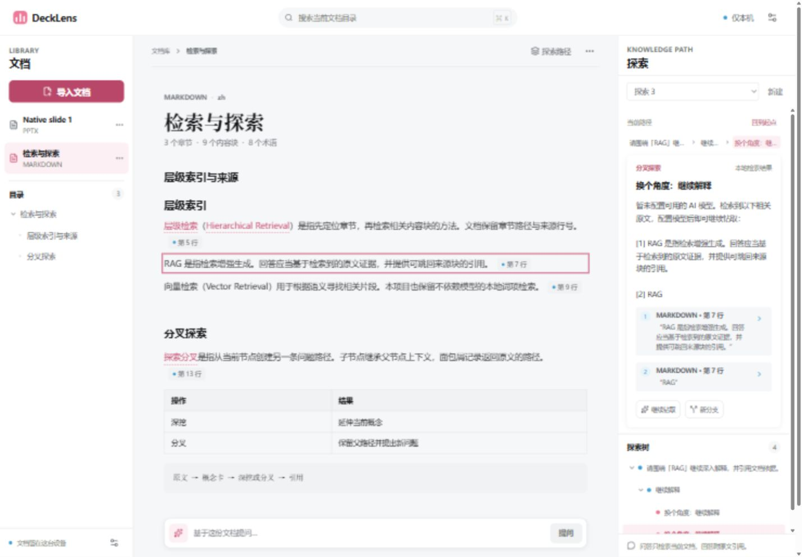
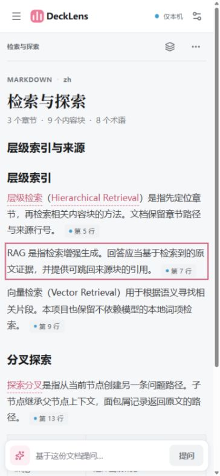

# DeckLens

DeckLens 是本地优先的交互式学习阅读器，把学习资料解析为带目录、原文定位、术语锚点和层级探索的文档。v0.1.0 提供本地浏览器版；当前可解析 Markdown、TXT 和 PPTX。PDF、DOCX 与 Electron 桌面安装包尚未实现。

## 功能

- 批量导入 Markdown、TXT、PPTX；按文件哈希去重，并支持重新解析。
- 按原文结构生成目录和内容块，保留章节、行号或幻灯片来源；手动调整章节会保存到本地。
- 右栏提供探索树。点击正文术语可生成解释节点；配置模型后可继续深挖、关联、分叉或追问，回答附带可跳回原文的引用。
- 中栏支持指针、画笔、荧光笔、橡皮和套索。标注按相对坐标保存；套索可将正文或图片区域加入探索。图片问答需要模型支持视觉输入。
- 可在模型设置中新增、编辑、切换和测试供应商配置。没有可用模型时，文档阅读、目录、标注和本地笔记仍可用。

注意：目前没有可用的底部全局提问框。AI 提问入口位于术语、探索节点和套索操作中。

## 三栏界面

- **左栏：**文档列表、导入入口和当前文档目录，可折叠并跳转到章节。
- **中栏：**结构化正文和来源标注；画笔与套索工具覆盖在正文上方。
- **右栏：**探索树、当前节点、引用和后续提问；可折叠。

较窄视口下目录和探索面板改为抽屉。以下截图来自合成文档：





## 支持的格式

| 格式 | 当前行为 | 已知边界 |
| --- | --- | --- |
| Markdown（.md、.markdown、.mdown） | 解析标题、段落、列表、代码围栏、管道表格、引用、独立图片，并保留行号 | 不是完整 CommonMark 排版器；HTML 作为文本处理；远程图片和本机相对路径不会自动读取 |
| TXT（.txt） | 解析段落和显式编号章节，保留行号；支持 UTF-8 与带 BOM 的 UTF-16 | 不会从无标题文本中臆造章节 |
| PPTX（.pptx） | 读取 OOXML 幻灯片顺序、标题、文本、项目符号、备注和内嵌图片，并将图片关联到所属幻灯片 | 不复刻原始幻灯片版式；复杂表格、SmartArt 和图表等尚未完整支持 |
| PDF（.pdf） | 识别 PDF 文件并给出明确的未支持提示 | 当前不解析原生文本层，也不提供 OCR |
| DOCX（.docx） | 识别 DOCX 文件并给出明确的未支持提示 | 当前不解析正文、表格、批注或图片 |

导入限制：一次最多 20 个文件，每个文件最大 512 MiB。PPTX 解包还有资源大小限制。解析任务在独立 Node 子进程中执行。超长文档尚未使用虚拟列表，超大文档的浏览器内存与交互性能未完成专项验收。

## 安装与启动

需要 Node.js 22.13 或更高版本、npm 10 或更高版本。

```powershell
npm ci
npm run dev
```

浏览器打开 `http://127.0.0.1:5173`。开发模式由 Vite 提供前端，并将 `/api` 请求代理到本机 Node 服务。

构建后启动本地服务：

```powershell
npm run build
npm start
```

打开终端打印的地址。默认服务端口为 `4173`；生产模式端口被占用时会选择可用端口并打印实际地址。服务仅绑定 `127.0.0.1`。

可在启动前设置数据目录和服务端口。数据目录必须位于源码仓库之外。

```powershell
$env:DECKLENS_DATA_DIR = Join-Path $env:LOCALAPPDATA 'DeckLens'
$env:DECKLENS_PORT = '4281'
npm run dev
```

`.env.example` 和 `config.example.json` 是供查看字段用途的示例，不会被应用自动加载。环境变量需在启动命令前由当前终端设置。

## 模型供应商配置

打开右上角设置按钮，在模型供应商页面新增配置，填写 Base URL、模型名称和 API Key，然后保存；可用“测试连接”验证配置。URL 必须是基础地址，不能把 Key、用户名、密码或查询参数放进 URL。服务端会为请求补上对应接口路径。

| 配置 | Base URL | Key | 模型名称 |
| --- | --- | --- | --- |
| DeepSeek 官方 | `https://api.deepseek.com` | 填写从供应商获得的 Key | 填写该账户可用的模型 ID |
| OpenAI 兼容服务 | 填写服务提供的 API 基础地址，例如 `https://api.example.com/v1` | 填写该服务的 Key | 填写该服务提供的模型 ID |
| Ollama 本机 | `http://127.0.0.1:11434` | 留空 | 填写本机已安装的模型名称 |

OpenAI 兼容配置请求 `/chat/completions`；Ollama 请求 `/api/chat`。非本机 HTTP 地址会被拒绝，远程服务需使用 HTTPS。Anthropic Messages 目前仅预留配置选项，不能连接或调用。

连接测试会发送一条简短请求；远程供应商可能按其服务规则计费。图片提问还要求配置中启用视觉能力，并由所选模型实际支持图片输入。配置中的流式能力开关不代表当前探索面板已经实现逐 token 流式显示。

## 数据位置与备份

默认数据目录：

- Windows：`%LOCALAPPDATA%\DeckLens`，若该变量不可用则回退到 `%APPDATA%\DeckLens`
- macOS：`~/Library/Application Support/DeckLens`
- Linux：`$XDG_DATA_HOME/decklens`，未设置时使用 `~/.local/share/decklens`

目录主要内容：

```text
DeckLens/
  db/decklens.sqlite                  文档、目录、内容块、探索、标注及设置
  originals/{documentId}/             导入的原始文件
  assets/{documentId}/{versionId}/    从文档提取的图片
  config/provider-secrets.json        本机模型密钥
  tmp/imports/                        导入临时文件
```

备份前先停止 DeckLens，再复制整个数据目录。恢复时停止服务并还原整个目录，避免数据库与原始文件、图片版本不匹配。备份可能包含原始私人文档和未加密的模型密钥，应放在受保护的位置。

阅读器的当前文档、滚动位置、目录展开状态和面板状态保存在当前浏览器的 `localStorage`，不在 SQLite 备份中；更换浏览器或浏览器用户配置后，这些界面状态不会自动迁移。探索节点、引用、标注、文档和解析版本保存在本地数据库。

删除整个数据目录后重启会自动创建新数据库。删除 SQLite 文件也会重建数据库，但不会自动从遗留的原始文件恢复文档索引。模型设置页可清除供应商 Key；完整删除本机数据时请先停止服务，再删除整个数据目录。

## 隐私与安全

- 导入和解析由本机服务处理，不会自动上传给第三方。浏览器版服务仅监听 `127.0.0.1`，并校验 Host、Origin 和跨站请求；不要通过反向代理、隧道或端口转发将服务暴露到公网。
- 只有用户触发 AI 操作时，检索到的原文片段、问题和所需上下文才会发送到所选模型供应商。使用远程供应商时，请按其隐私与数据保留政策评估；Ollama 配置指向本机服务时，请确认模型服务也只在本机可访问。
- API Key 在浏览器设置表单中输入时会短暂存在页面内存，并经本机 HTTP 请求交给后端；保存后表单清空，后端不会通过配置查询接口回传 Key。Key 以 JSON 文件保存在数据目录的 `config/provider-secrets.json`；应用不对该文件做静态加密，也不会把 Key 写入 SQLite 或仓库。文件在支持 POSIX 权限的系统上设置为 `0600`；Windows 使用用户数据目录的系统 ACL。请保护操作系统账户和备份。
- 当前版本没有 Electron renderer。未来桌面版的进程隔离和密钥输入路径尚未实现或验证。
- 本项目不提供账号系统、云同步或多人协作。

## 常见问题

**启动时提示 Node 或 npm 版本不支持？**

确认 Node.js 至少为 22.13、npm 至少为 10，然后重新执行 `npm ci`。

**开发端口被占用？**

默认 Node 服务端口为 `4173`。设置 `DECKLENS_PORT` 后，在同一终端重新启动前后端，以便开发代理与服务端使用相同端口。生产模式会选择可用端口并打印地址。

**为什么 PDF 或 DOCX 没有正文？**

v0.1.0 只识别并提示这两种格式尚未支持，不会执行 PDF、DOCX 解析或 OCR。

**没有模型时能做什么？**

可以导入和阅读文档、使用目录和标注、创建本地笔记。AI 术语解释、探索和圈选提问需要先配置模型；底部全局提问框仍未接入。

**Ollama 测试连接失败？**

确认 Ollama 已在本机启动、模型已下载，并填写 `http://127.0.0.1:11434` 和本机模型名称。Ollama 配置不需要 API Key。

**如何更换或重置数据目录？**

停止服务后设置 `DECKLENS_DATA_DIR` 指向仓库外的目录。应用不会自动搬迁旧数据；需要迁移时应先停止服务并完整复制旧数据目录，再指定新位置。

## Electron 桌面版

v0.1.0 **没有可打包的 Electron 桌面应用**。`apps/electron/README.md` 记录的是未来接入边界；当前没有 Electron 依赖、主进程、preload、安装器或打包脚本。因此 `npm run build` 只构建 Core、Node 服务和 Web 前端，不会生成 EXE。桌面版的构建方式将在实现并验收后补充。

## 开发目录

```text
apps/
  server/          本地 HTTP 服务、来源校验和导入任务
  web/             Vue 3 + Vite 前端与浏览器平台 adapter
  electron/        后续桌面接入说明，当前无运行代码
packages/
  core/            解析、统一文档模型、探索、检索、Provider 和 SQLite
  contracts/       前后端共享类型与后续设计
  host-node/       Node 宿主边界说明
database/          运行迁移说明及目标 schema 设计
config/            非敏感的供应商预设与配置约定
docs/              架构、验证记录和合成界面截图
tests/             Core、浏览器集成与架构检查
```

开发检查命令：

```powershell
npm run typecheck
npm test
npm run build
npm run check:architecture
```

## 许可

DeckLens 按 MIT License 发布，详见 [LICENSE](LICENSE)。

