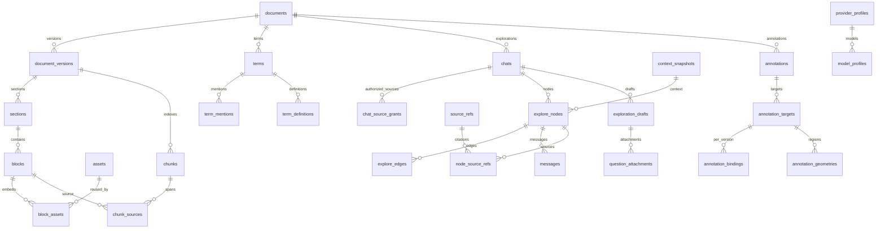

# DeckLens 数据库设计草案

本目录只交付下一版数据架构设计。`design/schema-vnext.sql` 可以在空的临时 SQLite 中建表，但没有接入应用、现有 `packages/core/src/database.ts` 或任何启动迁移。**不得把草案直接执行到现有用户数据库。**

本轮不实现业务服务，不执行真实数据迁移，不创建或读取用户目录数据库。SQL 没有种子数据，也不设置 `PRAGMA user_version`。

## 数据关系



## 字段与约束约定

- 业务 ID 为后端生成的不透明字符串；时间为 UTC ISO-8601；页码和幻灯片号从 1 开始，排序与文本 offsets 从 0 开始。
- 文本 offsets 统一采用 JavaScript UTF-16 code units，区间为 `[start,end)`。数据库只校验非负和区间顺序，core 还须验证不切开 surrogate pair、区间未越过原始 `plain_text`、quote 与原文一致。不能用 SQLite `length()` 代替此校验。
- `*_sha256` 为 64 位十六进制摘要；SQL 校验长度，core 校验字符集合和重新计算结果。
- `*_json` 检查 JSON 有效性及对象/数组类型。每个 JSON 载荷仍要经过 contracts 的版本化 schema 校验；数据库 CHECK 不替代参数校验。
- 路径采用相对用户数据根目录的 POSIX 分隔符。SQL 拒绝绝对路径、盘符、反斜杠及 `..`/`.` 路径段；存储服务还须执行 realpath containment、拒绝符号链接越界，并通过 assetId 或 attachmentId 访问。
- 所有连接启用 `foreign_keys=ON`；真实运行环境的 WAL、busy timeout 和备份策略由未来数据库驱动处理。草案只在内存验证。
- 允许同级 `display_order` 暂时相同，查询以 ID 作确定性次序，便于一次事务内重排；所有显式排序非负。

## 文档、版本与阅读结构

| 表 | 关键字段及用途 |
|---|---|
| `documents` | `document_id` 主键；`original_sha256` 唯一，避免重复导入；原名、签名识别格式、MIME、大小、原始文件相对路径、标题、语种、library/attachment 可见性、状态、活动版本、时间与元数据。活动版本使用 `(document_id,active_version_id)` 复合外键。 |
| `document_versions` | `version_id` 主键；文档 ID、递增版本号、源文件摘要、parser ID/版本、统一模型 schema 版本、解析状态、native/ocr/mixed 标记、诊断、错误与时间。文档+版本号唯一。 |
| `sections` | 版本内的稳定 `source_key`、同版本父章节、标题、深度、`source_order`、`display_order`、parser/manual 来源、原始 locator。章节自身是版本实例，重解析会生成新实例。 |
| `section_edits` | 文档级手动 rename/move/split/merge/reorder 操作日志；基准版本、稳定 source keys、操作 payload、序号、applied/pending_review/rejected/undone。不得只保存最后一棵树而丢失用户调整意图。 |
| `blocks` | 全局 block ID；文档、版本、章节、同版本父块；稳定 `source_key`、两种排序、内容类型、原始文本、结构载荷、locator、native/text-layer/ocr、警告、语种和内容摘要。 |
| `source_key_aliases` | parser 的 source key 方案升级时保存旧 key 到当前块的显式别名；同版本同 alias 只指向一个块。 |
| `assets` / `block_assets` | 文件与引用分离：资产保存摘要、相对路径、MIME、大小、像素尺寸；关联表保存所属块、序号、原生 part path、crop/transform/位置与 alt text。相同图片可由多个页面或版本引用，不改变页面归属。 |

`source_order` 是 parser 产出的不可变全文来源顺序，`display_order` 是用户阅读顺序；章节拖拽不得重写来源序号。source key 根据 OOXML part/element 路径、原生页内对象位置、Markdown/TXT 源行区间构造，禁止只按正文 hash 构造。两处完全相同文字仍是两处来源，不得全文去重。

内容块类型统一为 `heading | paragraph | list | table | image | formula | code | quote | note | divider | unsupported`。脚注、尾注、批注和幻灯片备注统一采用 note，并在 `payload_json.noteKind` 区分 `speaker-note | footnote | endnote | comment | general`。payload 还保存标题级别、列表嵌套、表格行列与合并、图片引用、公式原文、代码语言等。业务实现时需为每种类型定义 discriminated union；不得用任意 HTML 作为规范模型。

`source_locator_json` 与 vnext DTO 同口径：`documentId`、`documentVersionId`、`format`、`sourceHash`、`sectionId?`、`blockId?`、`sourceKey?`、`sourceSectionKey?`、`sectionPath?`、`pageNumber?`、`pageLabel?`、`slideNumber?`、`lineStart?`、`lineEnd?`、`charStart?`、`charEnd?`、`paragraphIndex?`、`nativePath?`、`excerpt?`、`boundingBoxes?`、`extractionMethod`、`isApproximate`、`confidence?`。原生容器 part/element 路径编码在 nativePath；OCR 警告保存在专用 recognition_warning 列并由公共块的 extraction warnings 返回。只保存实际可获得的位置；没有可信页码的 DOCX 不捏造页码。

重解析写入新版本，完成结构、图片、术语和索引后再切换活动版本。旧版本在被引用、注释或章节操作日志使用时保留。章节操作按 source key 重放，匹配有歧义则进入 `pending_review`，不静默丢弃或覆盖用户调整。

`outlineRevision` 不另设可漂移计数列：按文档聚合 `section_edits` 的 `MAX(ordinal)+1`，无日志为 0。章节编辑请求携带读到的 revision，写事务中核对后再追加操作。解析统计/选项保留在版本 `metadata_json`；块 warnings/confidence 通过版本化 source locator/payload JSON 保存并由 core 校验。

## 术语与检索

| 表 | 关键字段及用途 |
|---|---|
| `terms` / `term_aliases` | 文档级规范词、规范化词、语种、置信度、candidate/accepted/ignored；别名支持中英文全称和缩写。 |
| `term_mentions` | 精确到版本块与 UTF-16 offsets，保存实际 matched text、anchor/hover/hidden 和置信度；文档复合外键防止术语串库。 |
| `term_definitions` | source/ai 明确区分；原文版本、正文、AI 免责声明、可删除的模型档案引用、不可变非敏感模型快照、cache key、状态与时间。source 定义的证据通过 `definition_source_refs` 表关联，可有多条。 |
| `chunks` | document/section/leaf 层级索引块、同版本父 chunk、章节、全文序号、原始聚合文本、规范化检索文本、token 估计、摘要和 index 版本。 |
| `chunk_sources` | 一个 chunk 对应多个块片段，分别记录源块范围与 chunk 内范围，避免跨块拼接后丢失引用定位。 |
| `chunks_fts` | FTS5 external-content 表；insert/update/delete trigger 仅同步 `search_text`。chunk 的隐式 rowid 为不可变内部索引键，公开 ID 仍是 `chunk_id`；升级、VACUUM 和重建需做 FTS 一致性回归。 |

中文检索需要 core 生成经过分词或受控字词切分的 `search_text`；`unicode61` 本身不等于中文语义分词。查询参数化并转义 FTS 表达式。索引是派生数据，可以重建；证据必须回到 `chunk_sources` 和原始块，不能直接引用分词文本。

首版可用本地词法召回和章节扩展；向量检索不作为基础浏览依赖。长词优先、边界匹配、同屏高亮阈值和 hover 降级由术语服务与前端共同实施，不把每个出现位置都强制显示为链接。

## 探索树、分叉与证据

| 表 | 关键字段及用途 |
|---|---|
| `chats` | 文档级探索会话、标题、active/archived、时间。 |
| `explore_nodes` | `root/source/qa/deepen/relate/branch` 六种节点；标题、document/ai/user/system/mixed 内容来源、生成状态、免责声明、上下文快照、模型引用及快照、错误、软删除时间。**没有 parent_id。** |
| `explore_edges` | 唯一父子事实；同 chat 的 from/to 节点、`edge_role=tree/reference`、语义关系、标签、顺序及元数据；拒绝自环。 |
| `messages` | 节点内的 user/assistant 可见消息、顺序、生成状态、内容和元数据；不把全会话拼成一个无限聊天框。 |
| `context_snapshots` | 创建请求时固定的祖先路径、消息副本、检索配置、模型执行快照、上下文摘要、截断策略、token 预算、policy 版本和摘要；父快照必须属于同 chat。模型快照包含 provider configVersion、品牌/协议、脱敏 base URL、模型名/能力、实际请求参数和捕获时间。 |
| `source_refs` | 规范证据实体：文档、版本、块复合外键，精确 offsets、原文 quote/hash、locator、OCR 提示、可选 chunk 和注释 target/binding。不可通过修改引用把历史解释漂移到新版本。 |
| `node_source_refs` | 节点有多来源，关系为 anchor/evidence/context/related，并保存引用顺序及检索分值。 |
| `message_source_refs` | 回答消息的多引用，可定位引用所支撑的回答文本范围。 |
| `snapshot_source_refs` | 快照冻结实际采用的原文来源，保留来源类型和顺序。 |
| `definition_source_refs` | 术语定义的多个原文证据。 |
| `explore_view_state` | 按 chat + view 保存活动节点、原文版本/块/offset、展开集合、分支选择、面包屑、滚动锚点及面板状态，刷新后恢复；无 DOM 坐标或 arbitrary 文件路径。 |

`tree` 表示探索路径：root → source → deepen/relate/branch/qa 等。生成一个“关联解释卡”仍是有父节点的 `relate` 子节点；它与已有概念的横向关系另外保存 `reference` 边。`reference` 可以多对多，不改变树中父节点，也不参与面包屑。

SQL 已强制：同会话 FK、禁止自环、每 chat 最多一个 root、每个 tree 子节点最多一个父节点。**core 事务还必须强制：root 没有入向 tree 边、每个非 root 恰有一个 tree 父边、树无环、节点语义与 tree relation 一致。**新增/移动边前用递归 CTE 验证目标不是自身祖先，并在同一写事务中完成检查和变更。reference 环允许存在；递归遍历必须记录 visited 防止死循环。

分叉以当前祖先路径与 context snapshot 为起点创建新 `branch` 子节点，只继承所选路径；兄弟节点后续消息不自动进入上下文。深挖和关联亦新建节点，不回写原回答。模型档案删除只置空引用，历史模型快照保留。快照与证据不保存 secret、认证 header、图片 base64 或供应商原始错误正文。

reference 边不继承对方上下文。只有用户明确选择关联来源或添加附件，才把相应 source refs 固定进本次 context snapshot。source_ref 若带 chunk，服务必须额外核对 chunk_sources 确实覆盖所引块与文本区间；同版本复合 FK 不等于内容覆盖证明。

## 问题草稿与跨文档附件

| 表 | 关键字段及用途 |
|---|---|
| `exploration_drafts` | 独立持久化未提交问题；draft/chat/owner 文档、父节点、action、global/selection/node/term 入口、问题文字、context snapshot、context refs JSON、revision、active/submitted/discarded、提交节点与时间。父节点、快照和提交节点都使用同 chat FK。 |
| `question_attachments` | 从右侧“添加文件”建立的附件；属于一个 draft，保存独立 attachment ID、导入 job、来源文档/版本、授权 grant、状态、原名、顺序与错误。pending/parsing 可暂时没有来源文档；ready 必须具备文档、版本和授权。 |
| `chat_source_grants` | 会话级显式来源授权：owner 文档、source 文档、primary/attachment、授权时间和撤销时间。主文档也需要 primary grant；一个 chat 对同 source 最多有一条未撤销 grant。 |
| `draft_source_refs` | 问题局部选区、锚点、上下文和附件的规范来源关系；含 owner/source 文档、chat 和 grant，持久化后刷新不丢失。 |

`source_refs.source_document_id` 只表示证据来自哪份文件。node/message/snapshot/draft 的来源联接表分别保存 `owner_document_id` 与 `source_document_id`：owner 通过复合 FK 固定到所属会话和节点，source 通过复合 FK 固定到正确 source_ref，再通过 `(chat_id,source_document_id,grant_id)` 限定已授权来源。跨文档来源不会因属于另一个文档而被拒绝，也不能跳过授权读取整个本地库。术语原文定义继续限定在术语所属文档；跨文档关联通过探索节点表达。

右侧添加文件只更新当前 draft，生成 attachment 可见性的文档或复用相同 hash 的既有文档，不更换 chat.owner 文档、不切换中间阅读区。普通文档被用作附件时不会降低 library 可见性；附件后续被用户主动加入文档库时可提升可见性。提交时锁定 draft revision，确认附件已 ready、授权仍有效、原文来源及 context refs JSON 与规范联接一致，然后在同一事务创建 snapshot/node/edges/messages 并标记 draft 已提交。并发修改 revision 不匹配应明确返回冲突。

授权撤销后历史 grant 行保留，以便已有节点的引用仍可解释；core 必须拒绝用 revoked grant 建立新请求或新来源联接，SQL 的历史 FK 本身不判断“当前有效”。移除问题附件只标记 removed 并更新 draft，不删除被历史探索引用的来源文档或文件。尚未提交的附件授权须随移除撤销；正在生成的请求由服务取消或冻结已获授权的快照后再处理。删除被其他会话引用的来源文档应明确提示依赖，不能静默破坏其他探索路径。

## 注释跨版本保留

| 表 | 关键字段及用途 |
|---|---|
| `annotations` | 文档级稳定注释身份；note/highlight/underline/strike/shape/freehand、pointer/pen/highlighter/eraser/lasso 工具、标题、Markdown 正文、样式、revision 与软删除。笔记正文以此表为唯一事实。 |
| `annotation_targets` | 注释可有多个目标；记录原始版本/块、source key、精确 quote/hash、前后缀、reference content hash、原布局指纹、原始 locator、文本范围和顺序，保留最初的用户意图。 |
| `annotation_geometries` | target 下多个 rect/ellipse/polyline/polygon/point；归一化页面/块/原图坐标、页号、矩形、旋转、点集、reference content hash、layout fingerprint 及顺序。`reference_width/reference_height/reference_rotation_degrees` 是参考画布原始尺寸与朝向，`x/y/width/height/rotation_degrees` 是选区本身；image/snapshot asset 通过同文档复合 FK 关联。normalized-image 必须给出 asset，页面坐标必须给出页号。 |
| `annotation_bindings` | 每 target、版本、segment_index 一条绑定，支持一个旧目标在新版本跨多个块分段；exact/fuzzy/manual/orphaned/ambiguous/layout_stale、解析后块与区间、matched content hash、layout fingerprint、置信度、locator 和映射说明。新版本新增绑定，旧目标与旧绑定保留。 |
| `annotation_attachments` | 附件文件相对路径、原名、MIME、大小、摘要和注释归属。 |

重新解析依次尝试稳定 source key、alias、quote+上下文/hash；候选不唯一则标注 ambiguous，候选集合保存在 mapping_json，不假选一个 block。单个近似候选标记 fuzzy，等待确认；无法定位则 orphaned，注释仍可打开。跨多块选区拆成同一 annotation 下的多个 targets。

归一化坐标只能适应视口缩放，不能证明重排后的位置仍正确。reference content hash 或 layout fingerprint 变化时，区域注释保留旧 geometry 并标记 layout_stale，直到用户重绑或有可信版面映射。严禁直接把旧坐标覆盖到新页面上假装精确定位。

`normalized-image` 使用原始 asset 尺寸与摘要作为参考，不依赖响应式正文重排；仍要校验其内容摘要、旋转和裁剪映射。layout fingerprint 必须可重算，不能省略后宣称精确匹配。`mapping_json` 保留 resolved/candidate targets、method、reason、confirmedByUser 等版本化字段；多分段通过 segment_index 保留原 target 身份。

source_refs 可以引用已解析的 annotation target/binding，其 `(source_document_id,version_id,block_id,target_id,binding_id)` 必须与绑定一致。没有对应块的页面区域、orphaned/ambiguous target 或 layout_stale 几何仍保留，但不能伪装为精确块级证据；fuzzy 需明确显示待确认。服务只将 exact/manual 或用户已确认后新建的绑定作为精确引用。`annotation_excerpt` 与原文 quote 分字段保存，UI 必须区分个人批注与文档来源。

注释编辑与重新绑定不能重写历史快照：若需要修订已被引用的绑定，应新增 target revision/target ID 后产生新 binding，保留旧行；未来的版本回收必须先检查历史证据依赖，不能直接级联删除版本。

## 模型配置与安全边界

`provider_profiles` 保存品牌、协议、base URL、认证方式、启用状态、配置版本和 **opaque `secret_ref`**。`model_profiles` 保存远端模型 ID、显示名、默认参数、限制与能力验证信息；五种能力 `textInput/imageInput/streaming/tools/structuredOutput` 使用 `unknown/supported/unsupported` 三态 JSON，不能根据品牌默认推断。

SQLite 内不保存 API Key。SecretStore 仅在后端按 secret_ref 读取 `credentials/<providerId>.json`。renderer 和浏览器页面不提供密钥输入/回读通道；设置页只有“在本机编辑器配置凭据”、清除凭据和 status。后端只打开由自身生成的固定文件路径，不接受前端指定编辑器命令或任意路径；密钥由用户在系统本机编辑器中填写，刷新状态后只返回 `keyConfigured` / `configured` 等公开状态，公开 DTO 不返回 secret_ref、文件内容或已存密钥。options、参数、settings 和模型快照均使用字段白名单，禁止把 header、凭据或供应商原始响应塞进 JSON。

`settings` 当前仅允许 `ui.language`、`reader.preferences`、`ai.defaults.modelId` 三个精确 key；默认模型可以为 JSON null，由模型唯一确定 provider，不增加第二份 default_provider 标志。core 校验各 key 的值 schema。JSON 默认 ID 没有 SQL FK，删除模型时必须在同一事务清除或改写默认设置，启动遇到无效 ID 则退为未配置并提示。`import_jobs` 保存检测/解析/索引进度与明确错误，不保存上传临时绝对路径或文件正文。

## 用户数据目录与文件规则

数据根目录通过后端 StoragePaths 解析，浏览器版和未来桌面版共用。Windows 默认 `%APPDATA%/DeckLens`，macOS `~/Library/Application Support/DeckLens`，Linux `${XDG_DATA_HOME:-~/.local/share}/decklens`；显式覆盖路径仅用于开发/测试且必须在源码目录外。

```text
<userData>/
├─ db/decklens.sqlite                 # 及运行时 WAL/SHM
├─ originals/<sha256前2位>/<sha256>.<ext>
├─ media/<documentId>/<sha256>.<ext>
├─ attachments/<attachmentId>/<sha256>.<ext>
├─ notes/<documentId>/<annotationId>/attachments/ # 裁剪等二进制；笔记正文在库中
├─ exports/<exportId>/                # 用户主动导出的笔记/文档副本
├─ credentials/<providerId>.json      # 后端与系统本机编辑器独占
├─ backups/<UTC时间戳>/
└─ tmp/<jobId>/                       # 完成、失败或超时后清理
```

原名仅作为元数据展示，不能参与路径拼接；格式以文件签名与容器结构识别。媒体链接从 asset ID 解析，不接受前端传入任意相对路径。数据库只存相对路径和摘要，图片不转 base64 入库。笔记正文在 annotations；未来导出 Markdown 为派生文件，不引入数据库与文件两份可写正文。

原始文件相同 hash 只保留一个 document，用户主动重新解析增加 document_version。图片在文档内按摘要复用，但 block_assets 逐处保留图片归属。文件清理在数据库事务提交后执行，需检查引用并使用待删除队列或可恢复流程；不能先删文件再提交数据库。

## 验证与实施门槛

本草案仅验证空内存建表、外键一致性、代表性 FK/CHECK/唯一性拒绝场景、授权附件来源、draft 归属、FTS 同步及注释版本保留。SQL 可执行不代表业务已实现：章节重放、环检查、当前授权校验、source quote 校验、能力探测、SecretStore、注释重定位和 UI 均是后续阶段工作。

最终在 Node 24.19.0 内置 `node:sqlite` / SQLite 3.53.3 的 `:memory:` 库通过 88 项合成场景，`foreign_key_check=[]`、`integrity_check=ok`，另经独立只读复核。统计为 39 张普通表 + 1 张 FTS 虚表、49 个显式索引、3 个触发器，不计 FTS shadow 表与自动索引。未连接用户数据库，也未产生运行迁移。

批准 schema 后，先进行旧库字段映射与损失风险评审，再编写独立迁移与旧库 fixture 测试。规则详见 `migrations/README.md`。

SQLite 参考：[复合外键与 deferred constraints](https://www.sqlite.org/foreignkeys.html)、[JSON 校验函数](https://www.sqlite.org/json1.html)、[FTS5 external content 与触发器](https://www.sqlite.org/fts5.html)。
