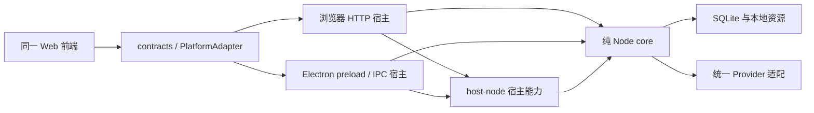

# DeckLens 新架构与实现边界

状态：**基础阅读与本地浏览器版多供应商模型配置已接入**。当前接通固定三栏、Markdown / TXT 与已有 PPTX 解析、文档版本和 SQLite 持久化，以及 OpenAI 兼容、DeepSeek、Ollama 的模型档案、调用、流式、连接测试和本地凭据文件；PDF / DOCX、画笔标注、完整探索 UI 与 Electron 仍是后续目标。`database/design/schema-vnext.sql` 继续隔离为设计快照，运行时仅执行必要的版本化迁移，不能把设计快照直接执行到用户数据库。

## 1. 以这一版为准

DeckLens 是本地优先、私密、离线友好的多格式 AI 学习阅读器。PDF、PPTX、DOCX、Markdown、TXT 统一进入可溯源的结构化文档；无模型时，导入、阅读、目录、图片和标注仍可使用。

- 固定三栏：左侧文件与目录，中间图文阅读及独立标注层，右侧对话式层级探索。旧版正文旁级联浮卡不继续发展。
- 右侧输入区采用紧凑的对话 composer。左下 `+` 提供「添加文件」「注释笔」；附件与圈选先进入待发送上下文，只有明确发送才请求模型。
- 层级动作统一为 `deepen / relate / branch`，原文是主线。父路径、分叉、来源、上下文快照及展开状态持久化，不能退化为无限追加的平面聊天。
- 结构化阅读必须包含图。原文件内图片按页、幻灯片或原段落绑定，不为凑图调用外部素材服务；生成解释引用原图时保留来源，不能假称文本模型理解了图像。
- 一个仓库、一套 Node core、一套 Vue 3 + Vite 前端。浏览器 HTTP 与 Electron IPC 只负责通道和宿主能力。
- API Key 只存在用户目录的宿主凭据存储，不进入 SQLite、renderer、公开 DTO、日志或仓库。应用页只显示是否已配置，并打开固定的本机凭据编辑入口。
- 不加入账号、云同步、社交、打卡、付费、多人协作。OCR 只作为后续可选能力；原生文档以原生结构解析。

## 2. 交付索引

| 需要审阅的内容 | 文件 |
| --- | --- |
| 总体边界、完整目录、开发顺序 | 本文 |
| Core 分层、平台方法、启动流程、安全与本地路径 | [core-and-platform.md](core-and-platform.md) |
| 文档、版本、章节、内容块、来源、图片与重解析 | [document-model.md](document-model.md) |
| 探索树、标注、模型等完整字段、主外键与索引 | [schema-vnext.sql](../../database/design/schema-vnext.sql) |
| 探索关系及数据库约束说明 | [database/README.md](../../database/README.md) |
| 迁移与旧库兼容策略 | [database/migrations/README.md](../../database/migrations/README.md) |
| 多供应商、能力与适配协议 | [providers.md](providers.md) |
| 三栏、标注、锚点、composer、组件与响应式 | [interaction.md](interaction.md) |
| 可检查的接口与模型类型 | [vnext/design.ts](../../packages/contracts/src/vnext/design.ts) |
| Electron 壳边界 | [apps/electron/README.md](../../apps/electron/README.md) |
| 非敏感配置及凭据约定 | [config/README.md](../../config/README.md) |

## 3. 单仓库目标目录

以下是目标规划，不表示每个模块已有实现。`[现有]` 代码继续保留；`[本轮]` 仅设计初始化；其余目录在对应开发阶段再创建，避免用空壳制造完成假象。

```text
DeckLens/
├─ apps/
│  ├─ server/                    [现有] 本机 Node HTTP 宿主
│  │  └─ src/{bootstrap,routes,security,events}/
│  ├─ web/                       [现有] 唯一 Vue3 + Vite 前端
│  │  └─ src/
│  │     ├─ design/               tokens、字体、布局规范
│  │     ├─ platform/             http / ipc adapter，composition root
│  │     ├─ stores/               reader、exploration、annotations、drafts
│  │     ├─ components/           三栏、块渲染、锚点、标注、探索卡
│  │     └─ pages/                workspace / provider settings
│  └─ electron/                  [本轮] README；后续 main / preload / resources
├─ packages/
│  ├─ contracts/                 [现有] 通道可序列化类型；不得引入 Node/UI
│  │  └─ src/vnext/               [本轮] 新设计草案，不覆盖旧运行时出口
│  ├─ core/                      [现有] 纯 Node 业务；后续按下列模块整合
│  │  └─ src/
│  │     ├─ application/          用例、事务边界、权限/归属校验
│  │     ├─ documents/            哈希、版本、导入任务、重解析
│  │     ├─ parsers/              detect、pptx、docx、pdf、markdown、txt
│  │     ├─ model/                统一模型校验、规范化、来源标识
│  │     ├─ outline/              章节树、编辑操作与版本映射
│  │     ├─ blocks/               块查询、排序、资源关联
│  │     ├─ exploration/          节点/边、路径、快照、会话
│  │     ├─ annotations/          语义锚点、笔迹、圈选与重绑定
│  │     ├─ retrieval/            切块、FTS、层级检索、证据选择
│  │     ├─ terms/                候选、原文定义、提及位置
│  │     ├─ conversation/         路径上下文、提问、回答、引用校验
│  │     ├─ providers/            registry、openai-chat、ollama-chat
│  │     ├─ storage/              repositories、SQLite、迁移执行器
│  │     └─ jobs/                 后台解析/索引任务协议与取消
│  └─ host-node/                 [本轮] README；后续共享目录/凭据/锁/worker能力
├─ database/
│  ├─ design/schema-vnext.sql     [本轮] 可在临时库检查的设计快照
│  └─ migrations/README.md        [本轮] 后续迁移规范，尚无线上升级脚本
├─ config/
│  ├─ README.md                   [本轮] 公开配置与私有凭据边界
│  └─ providers.example.json      [本轮] 非敏感供应商预置
├─ tests/
│  ├─ architecture/               [本轮] DDL、约束、配置与类型独立检查
│  ├─ fixtures/                   后续合成小文件，不放私人学习资料
│  ├─ core/                       后续解析/排序/关系/重解析测试
│  ├─ integration/                后续 HTTP/IPC 用例一致性
│  └─ e2e/                        后续三栏、标注、路径恢复、安全
├─ docs/architecture/             [本轮] 本次待确认设计
├─ .env.example / .gitignore
└─ package.json / package-lock.json
```

只采用 **npm workspaces + package-lock.json** 作为安装入口。旧 `pnpm-workspace.yaml` 本轮保留作为历史文件，不维护第二套锁。下一阶段统一 TypeScript/Node 类型版本及生产构建入口；不在本轮通过安装新依赖掩盖旧业务构建问题。

`database` 保存 DDL 与迁移资产，不是第二套持久层；实际连接和事务只在 core。`config` 只放示例，不存真实配置。`tests` 只放合成、授权公开或脱敏资料。

## 4. 依赖方向与职责



Web 不 import core、SQLite、Node fs、密钥存储或 SDK。Core 不 import Vue、DOM、Electron 或 HTTP 框架。HTTP/IPC handler 负责解包和调用同一用例，不重新编写解析、检索、上下文和数据库逻辑。`host-node` 为两个宿主提供通用基础能力，core 通过端口注入，不能由该层接管业务规则。

## 5. 分阶段进入开发

确认本设计后再开始业务整合。阶段是先后依赖，不是承诺的日历工期；拿到代表性合成文件和性能基线后再估算天数。

| 阶段 | 工作 | 完成后的可验证标准 |
| --- | --- | --- |
| 0：本轮 | 设计、类型、DDL、公开配置、独立检查 | `npm run check:architecture` 通过；不加载用户库、不请求模型；设计待确认 |
| 1：可构建基线 | 修复现有类型/构建错误，固定三栏取代浮卡入口，统一工具链 | clean install、typecheck、生产 build/start；无 mock 冒充已接通能力；四种宽度无溢出 |
| 2：存储与宿主边界 | 新模型、迁移、文件路径、锁、HTTP 校验、adapter | 空库自动建立；旧库升级回滚演练；错误Origin/路径逃逸被拒；secret不出DTO |
| 3：原生导入与图文 | PPTX/MD/TXT → DOCX → PDF；顺序、去重、worker、图片 | 同来源只建一块；不同位置相同句保留；图片所属页正确；百页文件可取消且UI仍响应 |
| 4：阅读和标注 | 目录编辑、锚点、笔迹/套索、图片区域、重绑定 | 缩放/换宽文本锚点不漂移；布局笔迹失配提示；重解析保留手调结构与旧引用 |
| 5：探索与composer | 节点/边、路径快照、分叉、附件、注释笔、视图恢复 | branch不继承兄弟内容；刷新恢复路径；加文件/圈选不会自动发送；原文始终可回跳 |
| 6：本地RAG和供应商 | FTS层级检索、OpenAI兼容/DeepSeek/Ollama、流式/取消/测试 | 无依据明确拒答；所有引用可校验；无模型不影响阅读；未知视觉能力不发送图片 |
| 7：浏览器验收 | 安全、坏文件、离线、重复导入、性能及备份 | 浏览器相关总验收项记录实际结果；无真实Key/私人资源进入提交候选 |
| 8：后续桌面 | 同一core/web接入IPC、安装包 | 两宿主同文件模型一致；无独立HTTP；无Node电脑安装运行；本轮不实施 |

## 6. 现有仓库状态与确认范围

仓库中已有上轮业务代码与未整合浮卡草稿。本设计保留这些文件，未将旧实现标为新版完成。基线类型检查已发现 core 的 `BlockRecord.sourceOrder` 缺失、Web 父节点局部推断错误；旧 `floating_state_json` 使用与迁移不配套。旧 README 的浮卡操作及构建描述属于历史实现说明，以本目录作为新版方向。

新 SQL 不替换旧 `packages/core/src/database.ts`，新类型不从旧 contracts 入口导出。后续迁移必须先验证数据备份、枚举转换、引用与手调章节保留，再接入应用。本轮已初始化本地 Git；未暂存或提交文件，尚未创建 GitHub 远端或私有仓库，不进行上传。

本次确认对象：三栏交互、版本化文档、探索树单父路径、多供应商/凭据隔离、宿主 adapter 与迁移方案。确认后从阶段1开始，不从完整重写或桌面打包开始。
